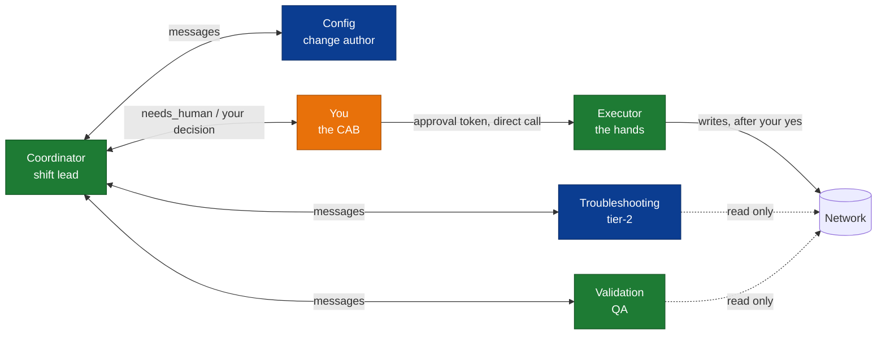
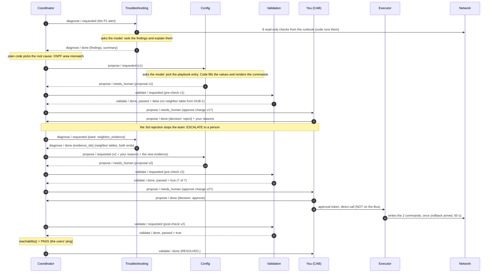

# Meet the team

Think of the team as one NOC shift working one P1. The **Coordinator** is the shift lead: it opens the tickets and
hands the work around, but never logs into a router. **Troubleshooting** is tier-2: it runs the standard checks and
writes up what it found. **Config** is the change author: it fills in an approved change template. **Validation** is
QA: it checks the change before anyone signs it, and checks the result after. **You** are the CAB: nothing is written
to a router until you say yes. The **Executor** is the hands: it types exactly the approved change, once, with the
rollback armed. Only two of these six roles ask the model anything, and even there the model never runs a network command: code does.

This page shows the code behind each role and how they talk. For the network, the kit and the cells you run, see
[How it works](HOW-IT-WORKS.md). Paths below are relative to the kit folder; every excerpt is copied from the file
as it is, and `...` means "lines left out here".

---

## The six roles at a glance



**Legend:** dark blue = asks the model · green = plain code, no model · orange = you. Solid lines = messages on
the Bus (or your approval token, handed over directly). Dotted lines = read-only.

| Who | NOC job | Asks the model? | May touch | Lives in |
|---|---|---|---|---|
| Coordinator | shift lead | no | sends messages; one final ping, `reachability()`; never configures | `netops/agents/coordinator.py` |
| Troubleshooting | tier-2 | yes: rank and explain | 6 read-only tools, run by code | `netops/agents/troubleshooting.py` |
| Config | change author | yes: pick the fix | nothing; commands come from `playbook.yaml` | `netops/agents/config.py` |
| Validation | QA | no | read-only checks | `netops/agents/validation.py` |
| **You** | the CAB | - | approve or reject | `GateRequest` in `netops/agents/coordinator.py` |
| Executor | the hands | no | the router, only after your yes, rollback armed | `netops/executor.py` |

## One incident, start to finish

This is what happens when the Lab 4 team works the P1: the first change (v1) is rejected, the second (v2) is
approved. The labels on the arrows are the real `intent / status` values of the messages (see
[How they talk](#how-they-talk)); a dashed arrow is a reply. Every arrow is one message on the Bus, except the
three that touch the Executor or the Network: those are direct Python calls, not messages.



In NOC words: tier-2 runs the checklist, the shift lead ignores the loud flap and works the fault that explains the
outage, QA bounces v1 ("what else rides on this link?"), CAB says no and writes down why, tier-2 pulls the neighbor
tables on both ends, v2 comes back with the evidence, CAB signs once, the hands make exactly that change, QA confirms
it, and the ticket closes.

---

## Coordinator - the shift lead

It receives the alert, sends each specialist its ticket, decides which finding to act on, and stops at you. Like a
shift lead: it routes the work and owns the incident, but it doesn't type on routers.

- **Lives in:** `netops/agents/coordinator.py` (class `Coordinator`)
- **Asks the model:** no. It passes the model on to Troubleshooting and Config, but never calls it itself.
  Choosing the root cause is plain code.
- **May touch:** it sends messages. It never configures anything. At the very end it calls `reachability()` (the
  users' ping) to confirm the result. "Never touches a router" is a design rule of this role; the code doesn't lock
  it out the way it locks out the specialists.

`netops/agents/coordinator.py`, lines 33-39, 68-73, 101-105:

```python
def choose_root_cause(findings: list[Finding]) -> Finding | None:
    """Act on the finding that explains the OUTAGE and has a playbook fix -- not on the loudest one."""
    playbook = load_playbook()
    for f in findings:
        if f.explains_outage and f.id in playbook and playbook[f.id].root_cause:
            return f
    return None
...
    def _send(self, to: str, intent: str, task: str, payload: dict) -> Message:
        return self.bus.send(Message(**{"from": self.name}, to=to, intent=intent, task=task, payload=payload,
                                     status="requested"))

    def diagnose(self, alert: str) -> list[Finding]:
        reply = self._send("troubleshooting", "diagnose", alert, {})
...
    def run_to_gate(self, alert: str) -> "GateRequest":
        self.diagnose(alert)
        if self.decide() is None:
            raise Escalation("no playbook fix for the diagnosed cause -- escalate to the on-call engineer")
        return self._gate(self.propose())
```

- `choose_root_cause` takes the first finding that **explains the outage** and has a **root-cause fix in the
  playbook**. The flap is loud, but the playbook marks it `root_cause: false`, so it is never picked.
- `_send` is how the Coordinator talks: it builds one `Message` with status `requested` and puts it on the Bus.
- `diagnose` sends the alert to Troubleshooting (`diagnose / requested`) and reads the findings from the reply.
- `run_to_gate` is the whole first half of the incident: diagnose, decide, propose. If no finding has a playbook
  fix, it raises `Escalation`: a person takes over, the team never improvises CLI.
- `_gate` (lines 111-119) then asks Validation to pre-check and sends you `propose / needs_human`.

## Troubleshooting - tier-2

It works out why the branch lost the service. Like tier-2 with a standard checklist: the checks are fixed, the
write-up is theirs.

- **Lives in:** `netops/agents/troubleshooting.py` (class `TroubleshootingAgent`)
- **Asks the model:** yes, for one thing: put the findings in order and write one line about each, plus a summary.
  The model can't add or drop a finding, and can't cite evidence that doesn't exist (the `validate` check, lines
  126-131). If the model gives no valid answer, code keeps the findings as detected.
- **May touch:** six read-only tools (`ALLOW`), on a read-only view of the network. Code runs them, in the order of
  `netops/data/diagnose.yaml`. The model is given no network tool at all.

`netops/agents/troubleshooting.py`, lines 20, 50-59, 109, 117, 133-134:

```python
ALLOW = ["ping", "route", "ospf_neighbors", "ospf_interface", "interface", "log_summary"]
...
def run_runbook(tools: ToolBox, params: dict) -> dict[str, str]:
    """Run diagnose.yaml in order. Returns {step_key: evidence_id}."""
    skill = yaml.safe_load(resources.files("netops").joinpath("data", "diagnose.yaml").read_text())
    got = {}
    for step in skill["steps"]:
        args = {k: v.format(**params) for k, v in step["args"].items()}
        tools.call(step["tool"], args)
        key = f"{step['tool']}:{args['device']}"
        got[key] = tools.calls[-1]["ev"]
    return got
...
        got = run_runbook(tools, p)
...
        found = detect(self.ev, got, p)
...
        run = run_agent(self.llm, role=self.name, system=SYSTEM, task=prompt, submit=SUBMIT, validate=validate,
                        trace=self.trace)
```

- `ALLOW` is the tier-2 command authorization list. `ToolBox.call` refuses anything else with `ToolNotAllowed`
  (`netops/agents/tools.py`, lines 72-74).
- `run_runbook` runs the 8 steps of `diagnose.yaml` in order: ping, route, OSPF neighbors, OSPF interface on
  **both** ends, the interface counters, the log summary, and the healthy branch's neighbors to compare with. Every
  result becomes numbered evidence (`ev_01`, `ev_02`...).
- `detect` finds the faults with plain rules (link changes above a threshold = flap; adjacency not FULL and the areas
  differ = area mismatch). The model never decides **what** is wrong.
- `run_agent(...)` is the only model call. There is no `toolbox=` in it, so the only "tool" the model sees is the
  `submit_diagnosis` form (`netops/agents/loop.py`, line 54).

## Config - the change author

It turns the root cause into a change request. Like a change author who must use the approved template: pick the
template, and the values come from the show output, not from memory.

- **Lives in:** `netops/agents/config.py` (class `ConfigAgent`)
- **Asks the model:** yes: which playbook entry to use, the reasoning, and one sentence on the blast radius. The
  model may also suggest extra commands; they are blocked (below).
- **May touch:** nothing on the network. It reads only the device's OS type and name. It never applies anything:
  it returns a proposal.

`netops/agents/config.py`, lines 62-63, 66-71, 74-76, 94-95:

```python
        run = run_agent(self.llm, role=self.name, system=SYSTEM, task="\n".join(lines), submit=SUBMIT,
                        validate=validate, trace=self.trace)
...
        # Code, not the model, has the last word on parameters: they must match the evidence.
        params = {"uplink": finding.observed["uplink"], "expected_area": finding.observed["peer_area"]}
        corrected = sub and sub.get("params") != params
        commands = render(entry, params, nos=nos)
        rollback_params = {"uplink": params["uplink"], "current_area": finding.observed["local_area"]}
        rollback = render(entry, rollback_params, "rollback", nos=nos)
...
        _, blocked = CommandGate(entry.allowed_for(nos)).split(sub.get("extra_commands", []))
        for b in blocked:
            self.trace(self.name, f"BLOCKED before proposal: '{b.command}' ({b.reason})")
...
        return Message(**{"from": self.name}, to=msg.from_, intent="propose", task=msg.task,
                       payload={"proposal": prop}, status="needs_human")
```

- `run_agent(...)`: again no toolbox. The model fills in the `submit_proposal` form, and `validate` (lines 52-60)
  only accepts a playbook entry marked as a root-cause fix.
- `params = {...}`: **code overwrites the model's values with the evidence**: the uplink and the area the neighbor
  really runs. Whatever the model typed there is thrown away.
- `render(...)` builds the commands and the rollback from the templates in `playbook.yaml`. That is why the
  change is always exactly `interface Ethernet1` + `ip ospf area 0.0.0.0`.
- `CommandGate(...).split(...)`: any extra command the model suggested is checked against `allowed_commands`.
  Anything not allowed is logged as `BLOCKED before proposal`. Either way, extra commands never reach the change:
  the commands come only from `render`.
- The reply has status `needs_human`: a proposal always waits for a person.

## Validation - QA

It checks the change before you see it and checks the network after the write. Like a peer reviewer who has no ego
in the fix and only trusts what the routers say.

- **Lives in:** `netops/agents/validation.py` (class `ValidationAgent`)
- **Asks the model:** no. It is plain code; it isn't even given the model.
- **May touch:** read-only. Pre-check: `ospf_neighbors`, `ospf_interface`, `route`, `ping` (its `ALLOW` list).
  Post-check: the read checks written in the playbook's `expected_post_state`.

`netops/agents/validation.py`, lines 59-64, 67-70, 78-80:

```python
        cited = [i for i in prop.get("blast_radius_evidence_ids", []) if i in self.ev]
        seen = {self.ev.get(i).args.get("device") for i in cited if self.ev.get(i).tool == "ospf_neighbors"}
        need = {dev, peer["peer"]}
        add("blast_radius_evidenced", need <= seen,
            "neighbor tables on both ends cited" if need <= seen else
            f"no neighbor-table evidence for {sorted(need - seen)} -- what else rides on this link?")
...
    def post_check(self, prop: dict) -> list[dict]:
        ctx = {**self.net.context(prop["device"]), **prop["params"]}
        rows, waited = poll(self.net, prop["post_checks"], ctx, deadline_s=self.deadline_s, poll_s=self.poll_s,
                            evidence=self.ev)
...
        return Message(**{"from": self.name}, to=msg.from_, intent="validate", task=msg.task,
                       payload={"phase": msg.payload.get("phase", "post"), "checks": checks,
                                "passed": all(c["ok"] for c in checks)}, status="done")
```

- This is the last of 7 pre-checks (the others: the playbook entry exists, the commands are allowed, the commands
  are exactly the playbook render, the expected result matches, the fault is still live, the target value matches
  the neighbor).
- `blast_radius_evidenced` passes only if the proposal cites the OSPF neighbor tables of **both** ends of the link.
  v1 has no table from HUB-1, so this check fails, and `approve()` on v1 is refused.
- `post_check` doesn't read once and declare victory: `poll` re-reads every 3 s for up to 60 s until the expected
  state holds (OSPF FULL takes a few seconds on real routers).
- The reply is `validate / done` with `passed` = all checks OK.

## You - the gate

You read the proposal and the pre-checks, then approve or reject. Like the CAB: you don't type the change, you sign
it, and your signature is good for that exact change, once.

- **Lives in:** `netops/agents/coordinator.py` (class `GateRequest`, what you hold in the notebook as `gate`)
- **Asks the model:** no.
- **May touch:** two buttons: `gate.reject("your reasons")` and `gate.approve(...)`.

`netops/agents/coordinator.py`, lines 147-157, 206-212:

```python
    def reject(self, reasons: str) -> "GateRequest":
        self._refuse_if_spent()
        c = self.coordinator
        self._human(reasons, {"decision": "reject", "version": self.proposal["version"]})
        if self.proposal["version"] >= c.max_rejections:
            self._escalate(f"{self.proposal['version']} rejections (cap {c.max_rejections})")
        up = c.net.uplink(self.proposal["device"])
        reply = c._send("troubleshooting", "diagnose", "blast radius: neighbor tables on both ends",
                        {"want": "neighbor_evidence", "device": self.proposal["device"], "peer": up["peer"]})
        v2 = c.propose(version=self.proposal["version"] + 1, revision_note=reasons,
                       neighbor_ids=reply.payload["evidence_ids"])
...
        if not self.ready:
            failing = "; ".join(x["detail"] for x in self.pre_checks if not x["ok"])
            raise GateError(f"pre-checks are failing ({failing}) -- reject with your reasons instead")
        self.approved_by = who                                                     # spent from here on, even if apply raises
        self._human(f"Approved v{self.proposal['version']}.", {"decision": "approve"})
        token = c.approvals.approve(self.proposal, who, change_id=change_id)      # minted on the human's action, handed to the Executor
        execution = c.executor.apply(self.proposal, token)
```

- `reject` sends your decision as a message (`propose / done`, `{decision: reject}`) with your reasons.
- The third rejection stops the team: `_escalate` hands the incident to a person, and nothing is applied.
- After a rejection the Coordinator asks Troubleshooting for the neighbor tables on both ends, and Config writes the
  next version with your reasons and that evidence.
- `approve` is refused while any pre-check fails. You can't approve the same gate twice: one approval, one write.
- Your approval mints the approval token (`c.approvals.approve`) and hands it **straight to**
  `c.executor.apply(...)` in the next line. It never goes on the Bus.

## Executor - the hands

It applies the approved change and nothing else. Like a field engineer with a signed change form and a rollback
plan: no thinking, no improvising.

- **Lives in:** `netops/executor.py` (class `Executor`) and `netops/approval.py` (class `Approvals`)
- **Asks the model:** no. It doesn't even import it.
- **May touch:** the real router, the only role that can, and only `proposal["commands"]`, or `proposal["rollback"]`
  if it backs out. In the workshop it relies on two things: your approval token and the back-out timer. (Extra
  re-checks at write time exist only in the kit's hardened mode.)

`netops/executor.py`, lines 62-72, 89-91:

```python
    def apply(self, proposal: dict, token: ApprovalToken | None) -> dict:
        self._refuse_unless_safe(proposal)
        watch = [c for c in proposal.get("post_checks", []) if c.get("backout")]
        if not watch:                                        # refuse before the token is spent or anything is touched
            raise GateError("proposal has no backout check -- the executor can't own its rollback")
        unknown = sorted({c["tool"] for c in watch if c["tool"] not in READS})
        if unknown:
            raise GateError(f"backout check uses unknown read tool(s) {unknown}")
        self.approvals.consume(token, proposal)              # raises before anything is touched
        dev = proposal["device"]
        self.net.configure(dev, proposal["commands"], by=f"executor:{token.approver}")
...
        self.net.configure(dev, proposal["rollback"], by="executor:auto-backout")
        self._audit("change_rolled_back", f"executor:{token.approver}", dev, proposal["rollback"])
        return {"applied": proposal["commands"], "rolled_back": True, "waited_s": waited}
```

- `_refuse_unless_safe` does the extra re-checks of hardened mode; in the workshop they are switched off.
- It refuses a change that has no back-out check (here: "OSPF neighbor state = FULL").
- `self.approvals.consume(token, proposal)` checks your approval token **before** anything is touched.
- `self.net.configure(...)` writes the approved commands, once.
- If FULL doesn't arrive within 60 s, it writes the rollback by itself and reports `rolled_back: True`. (If a
  back-out check can't even be read, it rolls back too.)

And the check it runs first, in `Approvals.consume`:

`netops/approval.py`, lines 72-88:

```python
    def consume(self, token: ApprovalToken | None, proposal: dict) -> None:
        if not isinstance(token, ApprovalToken):
            raise GateError("no approval: a human must approve this change first")
        if not hmac.compare_digest(self._mac(token.digest, token.approver, token.run_id, token.expiry, token.tenant, token.device,
                                      token.change_id), token.mac):
            raise GateError("invalid approval signature")
        if token.run_id != self.run_id:
            raise GateError("approval belongs to a different run")
        if token.digest != digest_of(proposal):
            raise GateError("the proposal changed after it was approved")
        if token.device != proposal.get("device", ""):
            raise GateError("approval is for a different device")
        if self._clock() > token.expiry:
            raise GateError("approval expired")
        if token.mac in self._used:
            raise GateError("approval already used")
        self._used.add(token.mac)
```

- The approval token must be a real one, signed by this run's secret (`invalid approval signature` otherwise).
- It is bound to the **exact** proposal: change one character after approval and the digest no longer matches.
- It is bound to the device, it expires after 15 minutes (900 s), and it works **once**: a second use is refused.

---

## How they talk

Every agent sends and receives one kind of message. It has seven fields:

| Field | Meaning | In NOC words |
|---|---|---|
| `id` | a short random id | the ticket number |
| `from`, `to` | who sends, who receives | from / assigned to |
| `intent` | `diagnose`, `propose` or `validate` | the ticket type |
| `task` | one line of plain text | the ticket title |
| `payload` | the data: findings, the proposal, the checks, your decision | the attachments |
| `status` | `requested`, `done` or `needs_human` | open / resolved / waiting for CAB |
| `reply_to` | the `id` of the message this answers | "re: ticket ..." |

There is no "approve" intent and no "rejected" status: your decision travels as `intent: propose, status: done`
with `payload.decision` set to `reject` or `approve`.

A real pair from the run above: the Coordinator asks for the neighbor tables after your rejection, and
Troubleshooting answers.

```
{"id": "f160b40f", "from": "coordinator", "to": "troubleshooting", "intent": "diagnose",
 "task": "blast radius: neighbor tables on both ends",
 "payload": {"want": "neighbor_evidence", "device": "BRANCH-7", "peer": "HUB-1"},
 "status": "requested", "reply_to": null}

{"id": "2e99088e", "from": "troubleshooting", "to": "coordinator", "intent": "diagnose",
 "task": "blast radius: neighbor tables on both ends",
 "payload": {"evidence_ids": ["ev_11", "ev_12"]},
 "status": "done", "reply_to": "f160b40f"}
```

The **Bus** (`netops/protocol.py`) delivers each message and has two rules:

1. **It keeps every message.** `bus.transcript` is the incident timeline: 19 messages for the run above, in order.
2. **It refuses an approval token.** Before it logs or delivers anything, it searches the payload; an approval token,
   or a field named `token` or `mac`, raises `TokenLeak`. Your approval token can only reach the Executor through the
   direct call shown above.

`netops/protocol.py`, lines 75-86:

```python
    def send(self, msg: Message) -> Message | None:
        _scrub(msg.payload)
        self._log(msg)
        handler = self.handlers.get(msg.to)
        if handler is None:
            return None
        reply = handler(msg)
        if reply is not None:
            _scrub(reply.payload)
            reply.reply_to = msg.id
            self._log(reply)
        return reply
```

The Executor is not on the Bus at all: only Troubleshooting, Config and Validation are registered there
(`netops/agents/coordinator.py`, lines 63-64). For more on the message format, the tools and the evidence numbers,
see [How it works](HOW-IT-WORKS.md).

---

**The ones who think don't touch.**

**The one who touches doesn't think.**

**You decide.**
